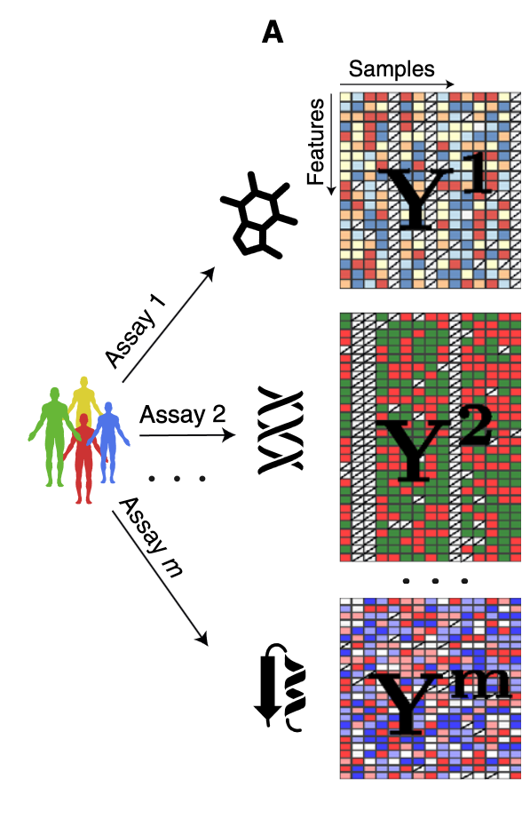
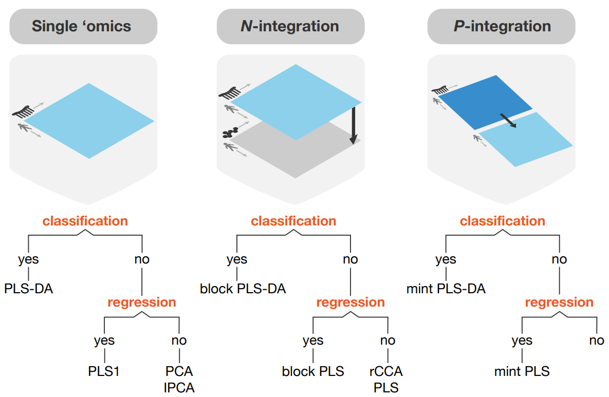
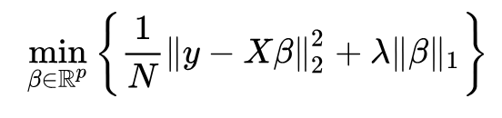
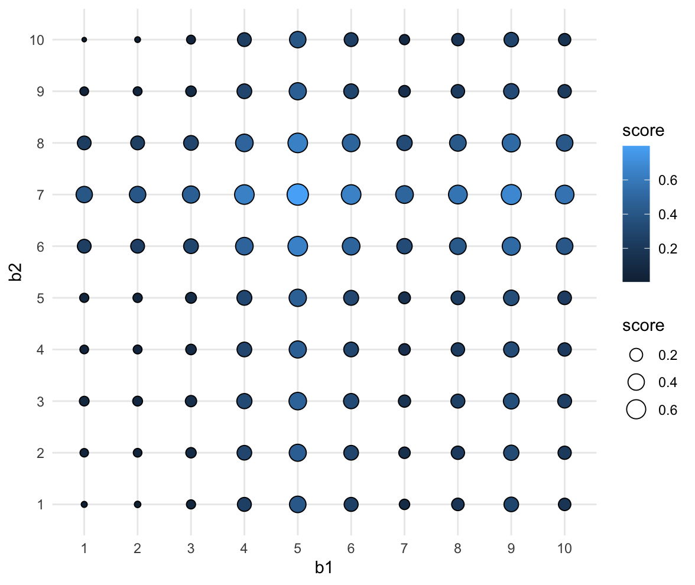
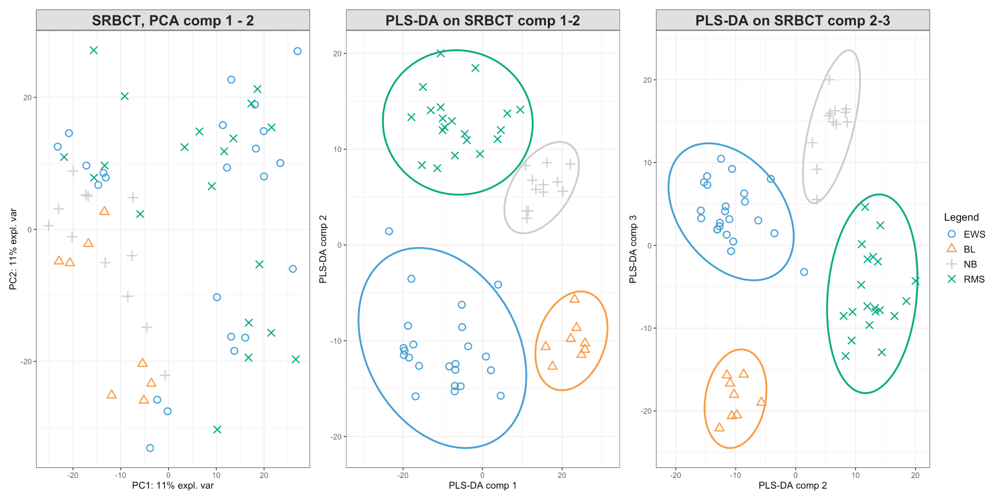
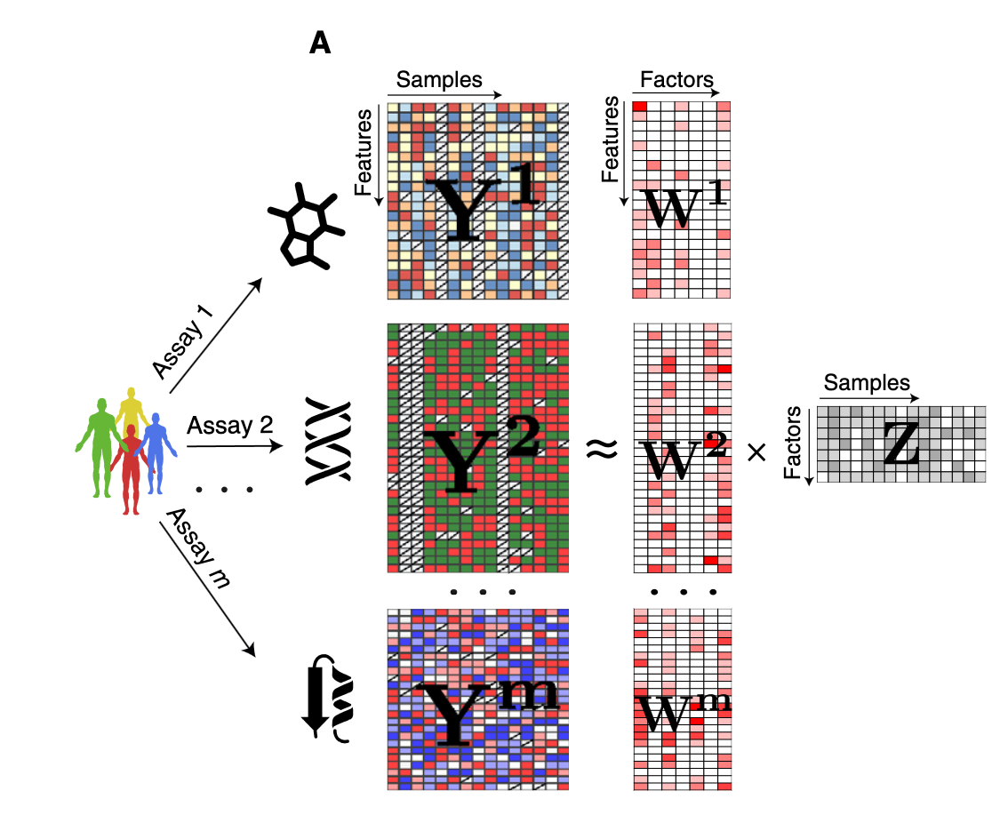
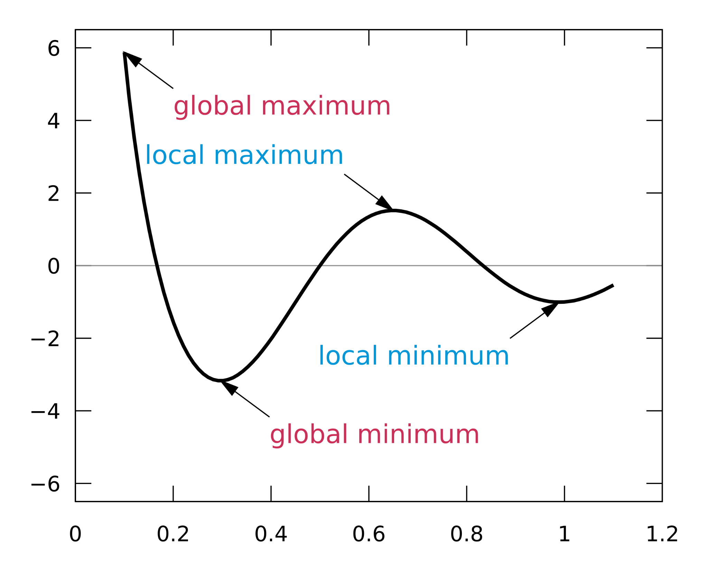
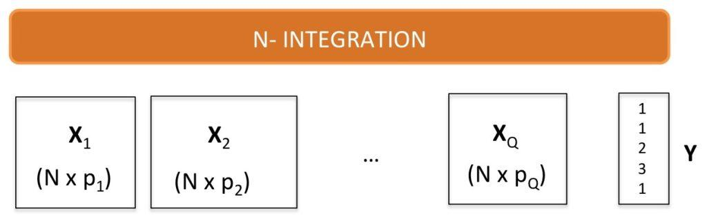
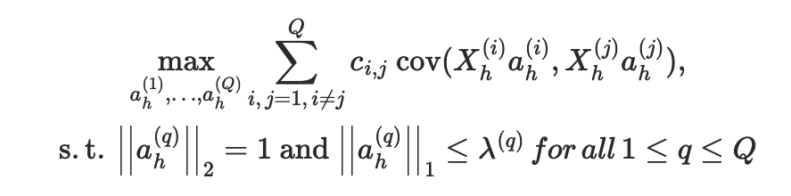

## Learning objectives

::: {.incremental}
- The principle of multi-omic integration
- **Supervised vs. unsupervised** approaches, and regularisation
- The concept behind **MOFA**, and how to read its output
- The concept behind **DIABLO**, and (s)PLS-DA
- Applying both to real data &mdash; CLL and TCGA-BRCA &mdash; in the lab
:::

::: notes
90 minutes total. Three scheduled question pauses: after the framing block
(~min 20), after the concepts block (~min 45), after MOFA (~min 68).
Keep this slide to 30 seconds &mdash; the recap at the end is where we check them off.
:::

## What is an omic?

:::: {.columns}

::: {.column width="45%"}
An **abstraction**: data about a set of samples.

- Typically large
- Quantitative *or* qualitative
- Sample sets should overlap across omics
- Some missingness is permissible

::: {.fragment}
It's just a **bunch of matrices** sharing columns (samples) and differing in
rows (features).
:::
:::

::: {.column width="55%"}
{height="480"}
:::

::::

::: notes
This is the single most important slide for the lab to make sense: everything
downstream is "matrices with shared columns".

Assay types to name out loud rather than list on the slide: RNA/DNA-seq
(expression, SNVs, SVs), proteomics (MS, antibody), methylation, chromatin
interaction (HiC, 4C), immunohistochemistry, drug response, microbiome.
Ask the room which ones they work with &mdash; cheap engagement, and it tells you
where to pitch the rest.
:::

## Types of integration

{height="440"}

::: {.caption}
Illustration from mixomics.org
:::

We will focus on **N-integration**: multiple omics, same samples.

::: notes
Multiple studies = P-integration. Multiple omics = N-integration. Both = MINT.

N-integration is what people usually mean by "multi-omics integration".
P- and N-integration both come down to projecting datasets into a common space.

END OF FRAMING BLOCK - pause for questions here (~min 20).
:::

## Some useful concepts {.section-divider .center}

## Regularisation

:::: {.columns}

::: {.column width="55%"}
{width="100%"}

**LASSO**: penalise the weights.

- Encourages *meaningful* variables to keep non-zero weight
- Snaps everything else to exactly zero
- &rArr; a sparse, interpretable model
:::

::: {.column width="45%"}
**How do you pick $\lambda$?** Or how many features to keep?

{height="330"}

Grid search plus a goodness-of-fit measure.
:::

::::

::: notes
This slide absorbed the separate "Parameter Optimisation" slide from 2025.
The point to land: regularisation buys interpretability, but it introduces a
parameter you now have to choose, and that choice is usually made by searching.

Keep it short here - the students will actually do this in the lab, where they
pick the number of factors themselves rather than accepting a handed-down value.
:::

## To supervise or not to supervise

:::: {.columns}

::: {.column width="50%"}
### Unsupervised

The data is the only thing we provide (plus some parameters).

- Clustering: hierarchical
- Embedding: **PCA**
:::

::: {.column width="50%"}
### Supervised

We add information: group labels, a response variable, the number of
components we want.

- Clustering: k-means
- Embedding: **PLS-DA**
:::

::::

. . .

::: {.callout-note appearance="simple"}
**PLS** finds a linear regression model by projecting predictors and observables
into a new space &mdash; unlike PCA, it maximises covariance *with the response*
rather than variance within X. **PLS-DA** is PLS where the response is categorical.
:::

::: notes
k-means is "supervised" here only in the weak sense that you hand it k.
Do not over-defend that framing if someone pushes back - the real contrast is
the next slide.
:::

## PCA vs PLS-DA on the same data

{width="82%"}

:::: {.columns}

::: {.column width="50%"}
```
> pca.srbct$prop_expl_var$X
       PC1        PC2        PC3
0.11210154 0.10746695 0.06393136
```
:::

::: {.column width="50%"}
```
> plsda.srbct$prop_expl_var$X
     comp1      comp2      comp3
0.09964595 0.05800961 0.05576462
```
:::

::::

PLS-DA separates the groups beautifully &mdash; and explains **less** variance.

::: notes
This is the most important slide in the deck. Let it breathe.

"Why would I ever not use the supervised method, it looks so much better?"
Because it looks better *by construction* - you told it the answer. The variance
explained numbers are lower precisely because it is optimising for separation,
not for variance.

And: you can only use it when you already know the groups. In discovery mode
you don't.

END OF CONCEPTS BLOCK - pause for questions here (~min 45).
:::

## Multi-omics N-integration {.section-divider .center}

## MOFA &mdash; the factorisation

:::: {.columns}

::: {.column width="63%"}
{height="470"}
:::

::: {.column width="37%"}
$$Y^{(m)} \approx W^{(m)} \times Z$$

One $W$ per view.

**One shared $Z$.**

That sharing *is* the integration.

::: {.fragment}
Hatched columns are **missing samples** &mdash; permitted, and exactly what the
lab's data-overview plot shows you.
:::
:::

::::

::: {.caption}
Argelaguet *et al.*, "Multi-Omics Factor Analysis &mdash; a framework for
**unsupervised** integration of multi-omics data sets", *Mol Syst Biol* 2018
:::

::: notes
Essentially PCA for multi-omics data. The CLL data in lab 01 is the dataset
from this paper - point at "unsupervised" in the citation line.

Walk it left to right: one Y per assay, all sharing the sample axis. Each Y is
approximated by a view-specific weight matrix W times ONE shared factor matrix Z.
Z is shared across all views - that sharing IS the integration.

Then advance the fragment for the missing-data point.
:::

## MOFA: what the model does

:::: {.columns}

::: {.column width="55%"}
**Inference** of hidden factors ($Z$) and loadings ($W$).

**Regularisation** induces sparsity two ways:

- *view- and factor-wise* &mdash; links factors to the views they are active in,
  and prunes factors that explain too little
- *feature-wise* &mdash; links factors to their most relevant features

**No guarantee of a global optimum.**

- Run it multiple times, keep the high ELBO
- Use `convergence_mode = "slow"`
:::

::: {.column width="45%"}
{height="420"}
:::

::::

::: notes
Regularisation here is the LASSO idea from earlier: snap weights to zero.

ELBO = Evidence Lower BOund, a lower bound on the log likelihood. Higher is
better. This is why the lab sets a seed - without one you get a different local
optimum each run and students would compare incomparable models.

The figure is the honest reason the seed matters.
:::

## MOFA: one noise model per data type

Implemented in a probabilistic **Bayesian** framework.

| Data | Likelihood |
|---|---|
| Continuous | Gaussian |
| Binary | Bernoulli |
| Counts | Poisson |

This is what lets a single model take methylation, expression, **mutations**
and drug response together.

::: notes
The maths is daunting and we will not delve into it.

What matters practically: in lab 01 you will set
`model_opts$likelihoods[["Mutations"]] <- "bernoulli"` by hand. This slide is
why. Getting that wrong is a common and quiet source of bad models.

END OF MOFA BLOCK - pause for questions here (~min 68).
:::

## DIABLO

{width="60%"}

**PLS-DA for multiple input blocks.**

- MOFA generalises PCA to multi-omics &rarr; unsupervised
- DIABLO generalises PLS-DA to multi-omics &rarr; **supervised**

Outcome variable $Y$: treatment group, sex, disease status, cancer subtype, &hellip;

::: notes
mixOmics: http://mixomics.org/mixdiablo/

The symmetry with MOFA is the thing to land. Same data layout, opposite
philosophy - and in lab 03 the students run both on the same TCGA data and
compare.
:::

## DIABLO: objective and the design matrix

:::: {.columns}

::: {.column width="55%"}
{width="100%"}

Maximise the **sum of covariances** between all pairs of datasets.
:::

::: {.column width="45%"}
**Design matrix $C$** for $Q$ datasets

$Q \times Q$, values in $[0, 1]$ (default `"full"` &rarr; all 1)

Encodes *prior knowledge* about the datasets:

- $< 0.5$ &rarr; focus on **discriminating the classes**
- $> 0.5$ &rarr; focus on **correlating latent components**
:::

::::

. . .

**Classification**: predict in each dataset separately, combine by majority vote
&mdash; optionally weighted by each component's correlation with the outcome.

::: notes
The design matrix is the single most DIABLO-specific idea here, and the one
students most often leave at the default without realising it is a modelling
choice. Say that out loud.

The lab uses the default. Ask them what they would change it to for the TCGA
data and why.
:::

## Where this sits, and what we covered

:::: {.columns}

::: {.column width="45%"}
**Other approaches**

- iCluster
- Group factor analysis
- MINT (for P- and N- together)
- &hellip; and plenty more

The two we covered are representative of the unsupervised/supervised split,
not exhaustive.
:::

::: {.column width="55%"}
**We covered**

- The principle of multi-omic integration
- Supervised vs. unsupervised; regularisation
- MOFA &mdash; concept and interpretation
- DIABLO &mdash; concept and (s)PLS-DA
- Next: both of them on real data
:::

::::

::: notes
Check the objectives off out loud against slide 2. If any of them did not land,
this is the moment to find out rather than after the lab.
:::

## The lab

:::: {.columns}

::: {.column width="55%"}
| | |
|---|---|
| **01** | MOFA2 on the CLL cohort &mdash; 4 omics, N=200 |
| **02** | The same cohort with mixOmics DIABLO |
| **03a** | MOFA vs DIABLO on TCGA-BRCA &mdash; run and interpret |
| **03b** | **Write your own code** |
:::

::: {.column width="45%"}
Before you start:

```
pixi run check
```

It must print `Environment looks good.`

**03b** is where you stop following along:

- characterise a factor against a covariate *your group* picks
- then: drop a modality and ask whether the integration was worth it
:::

::::

::: notes
Point out explicitly that 03b has no single right answer and that different
groups will get different results - that is the point, and we will compare at
the end.

Expect the mofapy2 version warning during run_mofa. Tell them now so nobody
loses ten minutes to it.
:::
